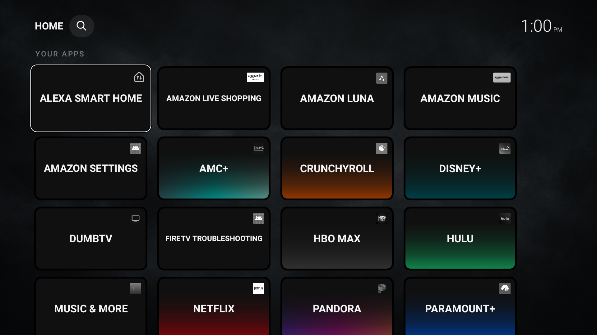
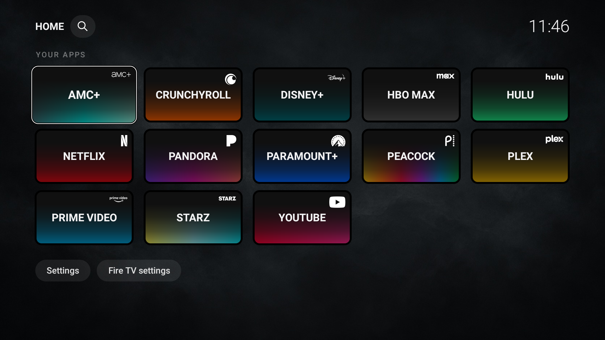

# DumbTV — Afterglow

Previously called Viking Theme. Community skin by vibe-code-viking, based on [humblemuzzu/dumbtv](https://github.com/humblemuzzu/dumbtv). Unofficial independent customization. Original code and notices remain under the MIT license in LICENSE.

A quiet TV dashboard with uppercase app names, optional monochrome corner icons, darkened brand-color fades, thin white focus outlines, black tile borders, and a bundled Charcoal Smoke wallpaper.

*Actual isolated test installation using installed app icons in grayscale. Optional user-supplied white logos are not included. The grid scrolls to additional apps.*

### Optional custom-logo example

*Customized installation with user-supplied white logos and a personal app selection. These logo files are not included in the release APK or supplied as an icon pack. App names and marks identify their respective services; no affiliation or endorsement is implied. This screenshot does not grant permission to reuse the marks.*

The Afterglow rename is being prepared for the next preview. The earlier release is still available as [Viking preview 0.1.0-preview.1](https://github.com/vibe-code-viking/dumbtv/releases/tag/v0.1.0-preview.1); its filename and label retain the old name.

## Status

Source preview. The generic version passed local build checks and an isolated fresh installation on a Fire OS 8 TV, including app discovery, theme switching and preference persistence. Home interception and recovery for the generic build have not yet been tested. The earlier household-specific variant was tested on one Fire OS 8 device. Native Fire TV text search uses an Amazon launcher helper and may vary by model or firmware. LG webOS is not supported by this Android launcher.

## Features

- Discover installed TV apps automatically, alphabetically by their installed labels. Apps without TV launcher entries can be enabled through the existing app-management controls.
- Settings > Tile style: Brand fades or Monochrome. Known package IDs receive curated accents; unknown apps retain neutral tiles.
- Settings > Background: Charcoal Smoke, Black, Graphite, Midnight and existing wallpaper modes.
- Settings > Corner app icons: Shown or Hidden. Built-in app icons are drawn in grayscale.
- Optional local PNG icon overrides; no service logos bundled and no internet permission added.
- No household allowlist, forced app names or one-time preference resets.

The launcher package remains `tv.dumbtv.home` for upstream compatibility. A differently signed APK cannot update an existing installation. Back up settings and understand the existing install/restore workflow before replacing a build. Do not uninstall an existing household installation merely to test this draft.

## Build and install

See [BUILDING.md](BUILDING.md) and [INSTALLATION.md](INSTALLATION.md). This fork is a launcher/theme customization. The upstream repository also includes broader device cleanup scripts: do not run them simply to install the theme.

## Optional icons

The default works without external logos. See [icons/README.md](icons/README.md) and [docs/ICON-WORKFLOW.md](docs/ICON-WORKFLOW.md). The catalog provides source pointers, not redistribution permission. No automatic web scraping or logo downloads run on the TV.

## Contributions

Use the icon request issue template for missing apps. Package aliases must be verified from real app metadata. A missing logo must never hide an app. Keep device identifiers, credentials, signing keys, pairing keys and raw diagnostic logs out of contributions.

## Credits

Upstream: dumbtv contributors. Theme customization: vibe-code-viking. Service names identify their respective apps; no affiliation or endorsement is claimed. Charcoal Smoke was AI-generated for this theme. See [ASSETS.md](ASSETS.md). Upstream documentation is preserved as README.upstream.md.
