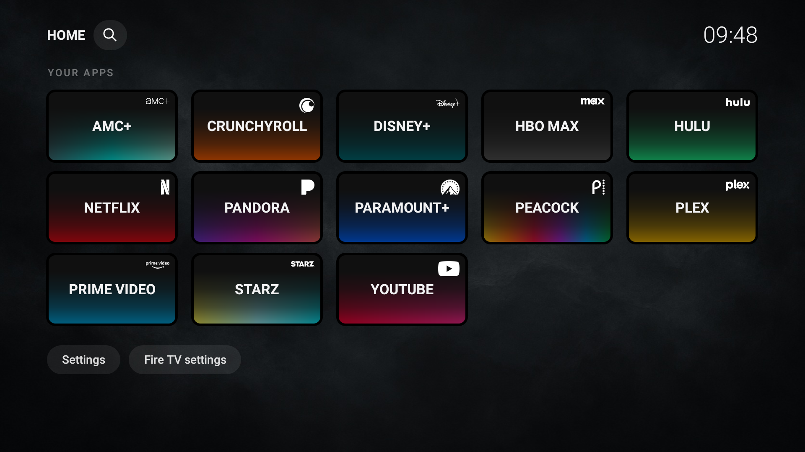

# Recreate the three-row Afterglow setup

This is a real Afterglow installation with the owner's settings, captured on
2026-10-26. It shows optional locally supplied white logos. Those logo files and
the owner's app selection are **not included** in the public APK. Without local
overrides, Afterglow uses installed app icons in grayscale.

## Appearance settings

Open **Settings** below the app grid:

| Setting | Value shown here |
|---|---|
| Accent color | White |
| Layout | Grid |
| App names | Never (the uppercase name inside each tile stays visible) |
| Clock | 24-hour |
| Inputs row | Hidden |
| Background | Charcoal Smoke |
| Wallpaper rotation | Off |
| Tile style | Brand fades |
| Corner app icons | Shown |

The Afterglow grid fits five columns in the standard landscape layout. Its grid
sizing is part of the skin; the inherited Tile size setting does not change this
five-column preset. There is no separate "three rows" switch: show **11 to 15
apps** for three rows. This example shows **13**, giving rows of five, five and
three. More apps add rows and scrolling. Hiding Inputs removes that extra row.
Image dim applies to external image wallpapers, not the built-in Charcoal Smoke.

## Choose apps and arrange them

1. In Settings, open **Apps on home screen**. Untick apps you do not want visible,
   including setup utilities and temporary preview apps. This hides tiles only;
   it does not uninstall or disable apps.
2. Keep your preferred 11–15 apps checked, then choose **Done**. The screenshot's
   choices are AMC+, Crunchyroll, Disney+, HBO Max, Hulu, Netflix, Pandora,
   Paramount+, Peacock, Plex, Prime Video, Starz and YouTube. Different services
   work too; you do not need to install these to use the layout.
3. Hold OK on a tile, or press Menu, to use **Move** or **Rename**. Arrange your
   selected apps alphabetically if you want the same ordering. The screenshot
   uses custom names such as "Peacock" and "Prime Video"; defaults come from the
   installed apps. Names are displayed in uppercase inside the tiles.
4. Leave Settings and use Home normally. Choices are saved locally. New installs
   discover their own TV apps; they do not receive this household's app list.

For permitted local icon overrides, see [the icon instructions](../icons/README.md).
White transparent service marks are optional personal customization, not a
downloadable logo pack supplied by this project. Screenshots do not grant rights
to the marks. Brand fades and the full layout work without overrides.

Existing personal Viking installs retain their saved ordering, names and
visibility when updated with a matching signing key. The old `apps.only` selection
is converted to the normal Apps on home screen visibility controls, so it remains
editable rather than becoming a hardcoded restriction.
